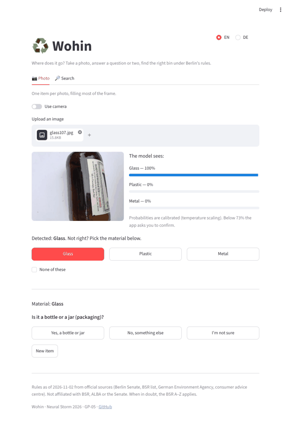
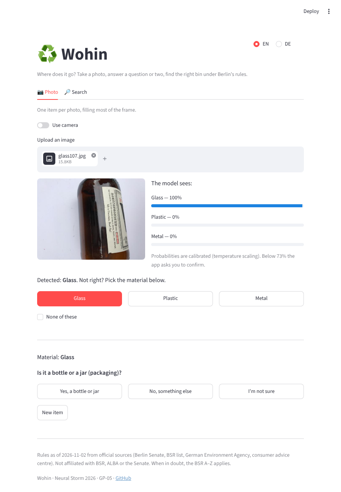
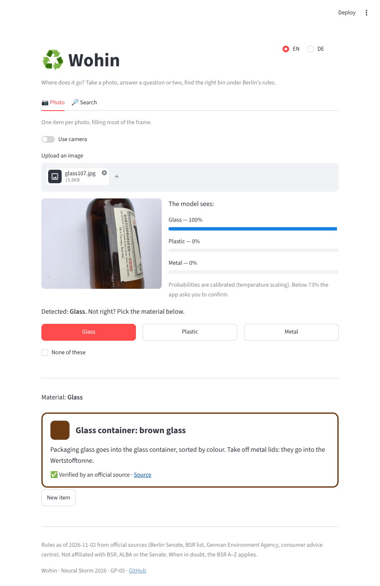
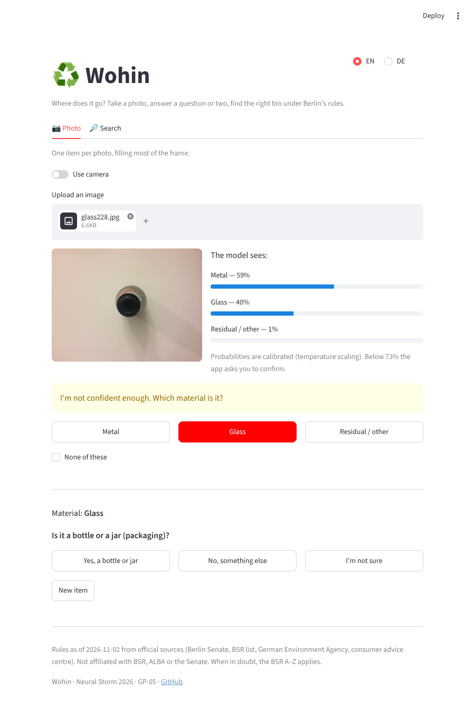
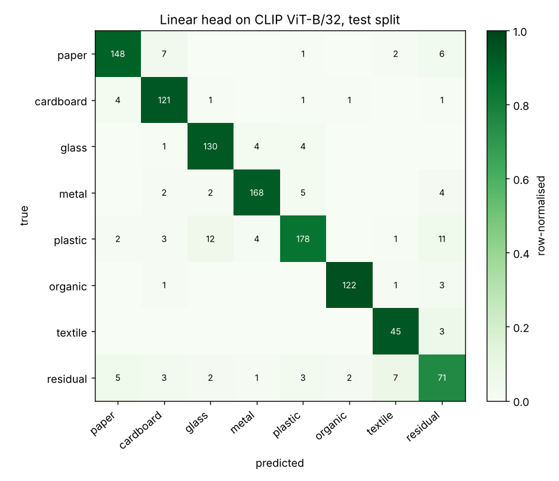
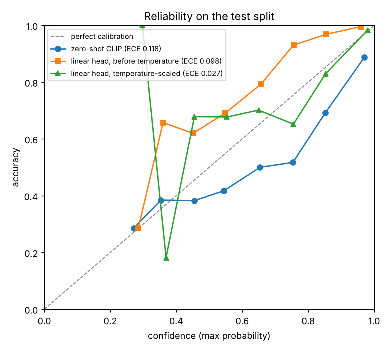

# ♻️ Wohin – where does it go?

**Photo-based waste sorting assistant for Berlin.**
Neural Storm 2026 · Track 2 *Green Planet* · Problem statement **GP-05: Smart Waste Segregation System**

> **Team:** `TODO(owner): team name and members`
>
> **Live demo:** `TODO(owner): Hugging Face Space link`



---

## 1. Problem

In Berlin, material alone does not decide the bin:

- A glass **bottle** goes to the glass container, sorted by colour. A drinking **glass**, mirror or window pane must not go there at all.
- A plastic bottle **with the deposit logo** goes back to a shop for 25 cents. Without it, it goes into the Wertstofftonne.
- Paper goes into the paper bin, but **used kitchen paper** goes into the Biotonne. A **beverage carton** goes into the Wertstofftonne.
- Food goes into the Biotonne, but never in a plastic bag, including "compostable" plastic bags.

People who have just moved to Berlin (international students, newcomers) do not know these rules, and the official A–Z lists assume you already know the German name of the item. Mistakes cost something: the Berlin Senate says that if foreign material in a Wertstofftonne impairs sorting and is not re-sorted, **the whole load goes to residual waste**, and that many Berliners put food waste into household waste although kitchen waste is what produces the most biogas ([source](https://www.berlin.de/sen/uvk/umwelt/kreislaufwirtschaft/projekte/bioabfaelle/biotonne-in-wohnanlagen/was-kommt-in-die-biotonne/)).

## 2. Solution

You photograph **one item**. An image classifier predicts its **material** (8 classes) with calibrated probabilities. A **rule engine built only from official Berlin sources** turns the material plus one or two follow-up answers ("Does it have the deposit logo?", "What colour is the glass?") into the right bin, and explains why with a link to the source.

- **Honest uncertainty.** Probabilities are temperature-scaled. If the top prediction is below a threshold chosen on the validation set, the app does not guess: it asks you to pick the material from the top three.
- **Never invents rules.** Every answer carries `verified: true | partial | false`. Only `true` is stated as fact; everything else is shown as guidance with a link to the [BSR A–Z](https://www.bsr.de/abfall-abc).
- **"I'm not sure" is always an option** in follow-up questions, and the rules define a safe answer for it.
- **German and English**, plus a **text search** over ~60 common items ("Pizzakarton", "receipt", "tea bag", "Kronkorken"), with umlaut folding and typo tolerance.

```
photo -> preprocess -> frozen OpenCLIP ViT-B/32 -> 512-d embedding -> logistic regression -> temperature scaling -> 8 material probabilities
                                                                                                                    |
                             bin card + explanation + source link  <-  rule engine (rules/berlin.yaml)  <-  follow-up answers
```

## 3. Screenshots

| Photo → prediction | Follow-up → bin card |
|---|---|
|  |  |
| **Low confidence → user picks from top 3** | **Text search (DE), unverified item → BSR A–Z** |
|  |  |

The example photos are from TrashNet (MIT). Screenshots were taken automatically with headless Chromium.

## 4. Technical approach

**Data.** Two public datasets, mapped to 8 unified classes (`wohin/data.py`):

| Unified class | TrashNet (2,527 images, white background) | RealWaste (4,752 images, landfill) |
|---|---|---|
| paper | paper | Paper |
| cardboard | cardboard | Cardboard |
| glass | glass | Glass |
| metal | metal | Metal |
| plastic | plastic | Plastic |
| organic | – | Food Organics + Vegetation |
| textile | – | Textile Trash |
| residual | trash | Miscellaneous Trash |

Splits are 70/15/15, stratified by unified label **within each source dataset**, seed 42 (`data/manifest.csv`: 5,094 train / 1,092 val / 1,093 test). A test checks that no image appears in two splits.

**Model** (`wohin/embed.py`, `wohin/train.py`). With only a CPU and 48 hours, we freeze a strong pretrained backbone and train a linear head:

1. **Backbone:** OpenCLIP ViT-B/32 trained on LAION-2B (`laion2b_e16` checkpoint). Embeddings for all 7,279 images are computed once and cached (257 s on 4 CPU cores, 28 images/s).
2. **Head:** multinomial logistic regression (scikit-learn) on standardised embeddings, `class_weight="balanced"` for the imbalanced classes, `C` tuned on validation macro-F1 (best `C = 0.003`).
3. **Calibration:** temperature scaling fitted on validation (T = 0.62; the regularised head was under-confident).
4. **Abstain threshold:** the lowest max-probability threshold whose validation accuracy reaches 95 % (t = 0.73). Below it, the app asks the user.
5. **Baseline:** CLIP zero-shot on the same backbone, with a prompt ensemble (several names per class × 4 templates), so the comparison isolates what the trained head adds.
6. **Alternative backbone:** timm EfficientNet-B0 (ImageNet), same head and calibration, to compare accuracy vs. latency.

**Rules** (`rules/berlin.yaml`, `wohin/rules.py`). One small decision tree per material; every node has an explicit branch for "I'm not sure". Every outcome has a bin, DE/EN text, a source URL and a verification level. Tests check that every outcome is reachable, has a source, and every question has DE and EN text. The facts come from the Berlin Senate, the BSR list on berlin.de, the German Environment Agency and the Verbraucherzentrale (all checked on 2026-11-02).

**Lexicon** (`rules/items.yaml`, `wohin/lexicon.py`). ~60 items with DE/EN names, a material and preset answers. Items our sources do not cover (pizza box, receipt, spray can, …) are marked `verified: false`; the app then only repeats the verified facts and links to the BSR A–Z.

## 5. Results

All numbers come from `artifacts/metrics/test.json` (test split, 1,093 images), produced by `uv run python -m wohin.train`.

| Model | Accuracy | Macro-F1 | Top-3 acc. | ECE | Coverage at threshold | Accuracy on covered |
|---|---|---|---|---|---|---|
| Zero-shot CLIP ViT-B/32 (baseline) | 0.676 | 0.618 | 0.873 | 0.118 | 0.327 (t = 0.95) | 0.941 |
| **Linear head on CLIP ViT-B/32 (deployed)** | **0.899** | **0.890** | **0.992** | **0.027** | **0.834 (t = 0.73)** | **0.951** |
| Linear head on EfficientNet-B0 | 0.868 | 0.861 | 0.986 | 0.026 | 0.794 (t = 0.76) | 0.940 |

- The trained head adds **+22 points accuracy and +27 points macro-F1** over zero-shot on the same backbone.
- **Calibration:** temperature scaling cuts ECE from 0.098 to 0.027 on test.
- **Selective prediction:** the app answers directly for 83 % of test photos with 95 % accuracy. For the other 17 %, the true material is among the top three shown to the user in 96 % of cases.
- **Per source** (does it learn materials or backgrounds?): RealWaste accuracy 0.900 / macro-F1 0.892, TrashNet accuracy 0.897 / macro-F1 0.874. Performance is similar on both domains.
- **Speed vs. accuracy:** EfficientNet-B0 is faster (24 ms vs. 56 ms per image on CPU) but 3 points less accurate; we deploy CLIP because 56 ms is fast enough for a photo app.

Per-class results for the deployed head (test):

| Class | Precision | Recall | F1 | Support |
|---|---|---|---|---|
| paper | 0.931 | 0.902 | 0.916 | 164 |
| cardboard | 0.877 | 0.938 | 0.906 | 129 |
| glass | 0.884 | 0.935 | 0.909 | 139 |
| metal | 0.949 | 0.928 | 0.939 | 181 |
| plastic | 0.927 | 0.844 | 0.883 | 211 |
| organic | 0.976 | 0.961 | 0.968 | 127 |
| textile | 0.804 | 0.938 | 0.865 | 48 |
| residual | 0.717 | 0.755 | 0.736 | 94 |

| Confusion matrix (deployed head) | Reliability diagram |
|---|---|
|  |  |

The main confusions are plastic → glass (transparent containers) and anything ↔ residual, which is a catch-all class by nature. The zero-shot confusion matrix is in `docs/img/confusion_matrix_zeroshot.png`.

**Near-duplicate check.** 57 test images (5.2 %) have a training image with CLIP cosine similarity ≥ 0.95. Accuracy on the remaining test images is 0.896, almost the same as overall, so near-duplicates barely inflate the score.

## 6. Limitations

- **Domain gap.** Both datasets show one item, either on a white background (TrashNet) or in a landfill (RealWaste). Photos taken in a Berlin kitchen look different; we have not measured accuracy on them. The abstain path and "pick the material yourself" help here.
- **Material ≠ item.** The classifier sees materials, not items. Questions like "deposit logo?" or "is it kitchen paper?" are asked, not inferred from the image.
- **Composite items** (beverage cartons, coffee cups, blister packs) are not a separate image class; the paper flow asks about beverage cartons, and the text search covers the rest.
- **Rules coverage.** Only rules from our cited sources are stated as fact. Lid colours for paper, Biotonne and household-waste bins are shown as swatches but are not named in the text, because our sources do not state them.
- **Datasets** are from the USA (TrashNet) and Australia (RealWaste), not from Berlin.

## 7. Tech stack

Python 3.11 · [uv](https://docs.astral.sh/uv/) · PyTorch (CPU) · [OpenCLIP](https://github.com/mlfoundations/open_clip) · [timm](https://github.com/huggingface/pytorch-image-models) · scikit-learn · SciPy · NumPy · pandas · Pillow · PyYAML · matplotlib · Streamlit · pytest · Playwright (screenshots only).

## 8. Setup

Requirements: Python 3.11 and [uv](https://docs.astral.sh/uv/getting-started/installation/). CPU is enough.

```bash
git clone https://github.com/hoongyu/wohin.git
cd wohin
uv sync
```

## 9. Run locally

**The app** (uses the committed head `artifacts/model/head.joblib`; the OpenCLIP weights, ~600 MB, are downloaded on the first photo):

```bash
uv run streamlit run app.py
```

Open http://localhost:8501. The text search works without any model download.

**Tests:**

```bash
uv run pytest
```

**Reproduce the model and metrics:**

```bash
uv run python -m wohin.data                    # download TrashNet + RealWaste, write data/manifest.csv
uv run python -m wohin.embed                   # CLIP embeddings -> artifacts/embeddings/ (~5 min on 4 cores)
uv run python -m wohin.embed --backbone effnet # optional: EfficientNet-B0 embeddings
uv run python -m wohin.train                   # fit heads, calibrate, evaluate -> artifacts/metrics/test.json, docs/img/
```

`wohin.data` tries the official download first and falls back to the GitHub copies (`git clone` of the TrashNet and RealWaste repositories). `wohin.embed` falls back to the OpenCLIP / timm GitHub release weights if Hugging Face is not reachable.

**Predict from the command line:**

```bash
uv run python -m wohin.predict path/to/photo.jpg
```

## 10. Project layout

```
app.py                 Streamlit UI
wohin/data.py          download, label mapping, splits -> data/manifest.csv
wohin/embed.py         backbones with download fallbacks, embedding cache
wohin/train.py         logistic-regression head, C search, temperature, threshold
wohin/evaluate.py      zero-shot baseline, test metrics, plots, near-duplicate check
wohin/metrics.py       ECE, temperature scaling, selective prediction
wohin/predict.py       image -> top-k calibrated probabilities
wohin/rules.py         rule engine over rules/berlin.yaml
wohin/lexicon.py       DE/EN text search over rules/items.yaml
artifacts/model/       trained heads (committed, ~30 KB each) + zero-shot text embeddings
artifacts/metrics/     train.json, test.json, embedding timings
docs/judging/          how Wohin addresses each judging criterion
deploy/huggingface/    Space metadata and deployment steps
```

## 11. Disclosure: tools, models, data

- **AI development tool:** this project was built with **Claude Code** (Anthropic), an AI coding assistant, which wrote the code, ran the training and evaluation, and drafted this documentation under the owner's design and direction.
- **Timeline:** the design document (`docs/superpowers/specs/2026-11-02-wohin-design.md`) and the task description (`docs/cloud-task.md`) were written before the Neural Storm build window opened. All code, data processing, models, metrics and screenshots were created after 2026-11-02 15:30 CET, inside the window (see the git history).
- **Pretrained models:** OpenCLIP ViT-B/32 (`laion2b_e16`, trained on LAION-2B; OpenCLIP code MIT). timm EfficientNet-B0 (`efficientnet_b0_ra`, ImageNet; timm Apache-2.0). Both are used frozen.
- **Datasets:**
  - TrashNet, Gary Thung and Mindy Yang, https://github.com/garythung/trashnet (MIT).
  - RealWaste, Sam Single, Saeid Iranmanesh, Raad Raad, *RealWaste: A Novel Real-Life Data Set for Landfill Waste Classification Using Deep Learning*, Information 14(12):633, 2023. Distributed by UCI (dataset 908) under CC BY 4.0; the authors' GitHub mirror, which we downloaded because UCI was not reachable from the build environment, states CC BY-NC-SA 4.0. This project is non-commercial, attributes the authors, and does not redistribute the images.
- **Rules sources:** Berlin Senate pages on berlin.de (Wertstoffsammlung, Biotonne, Alttextilien), German Environment Agency (UBA), Verbraucherzentrale, Stiftung Warentest (glass colours). Wohin is not affiliated with BSR, ALBA or the Senate.

## 12. Licence

`TODO(owner): choose a licence for the code.`
